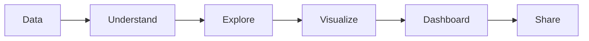

# Cevyn – Roadmap

## 1. Zweck

Diese Datei beschreibt den aktuellen Entwicklungsstand und die
nächsten Prioritäten.

Sie ist bewusst dynamischer als die übrige Dokumentation.

Status:

```text
Completed
Current
Next
Later
```

Nur tatsächlich implementierte und verifizierte Funktionalität darf
unter `Completed` stehen.

## 2. Current Product Stage

Visualization Core, Multi-Chart Canvas, Build Panel und die Bearbeitung
am Objekt (Format-Popover statt Inspector) sind in einem ersten
vollständigen Stand. Der nächste größere Meilenstein
ist der Data-Bereich: Cevyn soll einen geladenen Datensatz nicht nur
darstellen, sondern deterministisch verstehen.

Data Handling bleibt dabei auf Visual Analytics begrenzt und wird kein
ETL- oder Data-Engineering-Workspace.

## 3. Completed

### Data Foundation

- CSV Upload
- Dataset State
- Field / Schema Grundlage
- grundlegende Type Detection
- Rows-Preview-API und DataTable-Komponente

### Visualization Core

- Scatter Chart
- Line Chart
- Bar Chart
- Pie Chart
- Donut Chart
- Apache ECharts Integration
- X/Y Encodings
- Scatter Size Encoding
- Scatter Color Encoding
- Line Series
- Bar Series
- Pie-/Donut-Series über einen gemeinsamen radialen Content-Builder
- gruppierte Line-/Bar-/Pie-/Donut-Aggregation über Polars im Backend
- Legend für diskrete Series, Scatter-Kategorien und radiale Kategorien
- Continuous Color Scale für numerische Scatter-Color-Encodings
- backend-aggregiertes numerisches Color-Encoding für Bar-Charts
- unabhängige Value- und Color-Aggregation für Bar-Charts
- Legend Interaction mit Multiple-, Single- und deaktivierter Auswahl
- formatierte Standard-Tooltips für Scatter, Line, Bar, Pie und Donut
- Achsen-Formatierung: Titelfarbe, -größe und -gewicht, Tick Count
  (Auto/Custom) und Label-Rotation für X und Y

### Inspector Foundation

- Inspector
- Data Tab
- Appearance Tab
- Interaction Tab
- grundlegende chart-spezifische Properties

### Reusable Controls

- ColorControl
- kompakte ColorControl-Variante
- GradientControl für kontinuierliche Farbverläufe
- ScrubbableNumber
- FontWeightControl
- RotationDial mit Shift-Snapping und präziser Zahleneingabe
- zentrale Liquid-Glass-Surfaces (`.glass` in drei Stufen) mit
  Lichtkante, Ambient-Hintergrund und Reduced-Transparency-Fallback
- lokal eingebundene Schrift Inter Variable
- grundlegende Inspector Controls

### Multi-Chart Canvas MVP

- mehrere Charts gleichzeitig auf der Canvas
- Add per Klick oder Drag aus dem Chart Picker
- Select per Klick, Deselect per Klick auf freie Canvas-Fläche
- Move über eine obere Griffleiste
- Resize über alle Kanten und Ecken
- Einrasten im 24-spaltigen Grid mit Live-Vorschau
- Duplicate und Delete für den selektierten Chart
- Charttyp-Wechsel im Inspector
- Field-Drop auf die Achsen eines beliebigen Charts
- neuer Chart wird ins Bild gescrollt und kurz hervorgehoben
- Tooltips werden nicht mehr vom Chart-Rahmen abgeschnitten

### Cross-Highlighting MVP

- globale, feldbasierte Datenauswahl (`selection`) im Workspace State
- Selection per Klick auf Kategorien in Line, Bar, Pie und Donut
- Selection per Klick auf Scatter-Punkte mit kategorialem Color-Feld
- erneuter Klick oder Klick auf leere Chart-Fläche hebt die Auswahl auf
- alle Charts heben den Anteil der ausgewählten Zeilen hervor, auch wenn
  sie das Selection-Feld nicht selbst codieren
- Line und Bar: abgeblendete Basis mit überlagerter Highlight-Serie aus
  einer gefilterten Backend-Query
- Pie und Donut: Anzeige der gefilterten Verteilung mit stabilen Farben
- Scatter: Abblenden nicht passender Zeilen im Frontend
- Tooltip benennt die ausgewählte Kategorie, ohne Dopplung im
  Quell-Chart
- Backend-Chart-Query mit `filters`

### Brush Selection

- Selection als Liste von Werte- und Bereichsfiltern
- Rechteck-Brush im Scatter, immer aktiv; Klick und Mausrad-Zoom bleiben
  erhalten
- Brush erzeugt Bereichsfilter auf X und Y, alle Charts heben den Anteil
  der Zeilen im Rechteck hervor
- Rechteck wird aus der Selection gezeichnet und verschwindet, wenn die
  Selection gelöscht wird oder aus einem anderen Chart stammt
- Rechteck in Akzentfarbe, ohne zusätzliches Abblenden durch ECharts
- Backend-Bereichsfilter für numerische Felder

### Canvas Container und Direct Editing

- Chart-Container im Domain Model (`ChartInstance.container`), getrennt
  von der `ChartSpec`
- Container-Widget im Inspector: Background (Glass, Surface, None,
  eigene Farbe), Padding, Radius
- Glass als Default-Container; Hover- und Auswahl-Ring innen, auch bei
  dicht platzierten Charts sichtbar
- Charttitel als HTML-Header statt ECharts-Titel, mit Ausrichtung
  Start/Mitte/Ende
- Inline-Editing des Titels direkt im Chart
- Tastaturbedienung: Move, Resize, Delete, Duplicate, Escape
- nach dem Löschen wird der nächste Chart ausgewählt und fokussiert,
  sonst die leere Canvas
- wiederverwendbare Controls `AlignmentControl` und `EditableText`,
  `ColorControl` mit eigenen Presets

### Inline-Editing der Achsentitel

- X- und Y-Achsentitel direkt im Chart bearbeitbar; ECharts rendert die
  Titel weiter
- Adapter übersetzt Klick und Hover auf den Titel in ein Domain-Event
  mit Achse und Bounding Box (`AxisTitleEdit`)
- Input liegt über dem Titel, der Original-Titel wird währenddessen
  ausgeblendet; Y-Input wächst nach innen in den Plot
- Placeholder ist der Feldname; leerer Titel bedeutet automatischer
  Titel
- Hover-Fläche und Text-Cursor wie beim Charttitel
- Edit-Hälfte von `EditableText` als `InlineTextInput` herausgezogen;
  Pointer-Down außerhalb übernimmt den Wert, auch wenn ECharts (Brush)
  das Default-Verhalten unterdrückt

### Workspace Panels

- Panel-Header als einzeilige Icon-Label-Zeile statt Eyebrow und Titel
- Canvas ohne Titel; Header dient als Toolbar
- Build Panel und Inspector unabhängig einklappbar, eingeklappt als
  schmale Icon-Leiste, Breite animiert
- Shortcuts Cmd/Ctrl + B und Cmd/Ctrl + I

### Undo/Redo und Command-Registry

- History um den `workspaceReducer` mit `past`, `present` und `future`,
  begrenzt auf 100 Schritte
- nur Dokument-Änderungen sind undo-fähig; Chart-Auswahl und
  Datenauswahl nicht
- kontinuierliche Änderungen (Scrubbing, Slider, Farbpicker,
  Pfeil-Nudges) werden per Coalesce-Key und Zeitfenster zu einem
  Schritt zusammengefasst
- zentrale Command-Registry speist Shortcuts und Buttons aus derselben
  Befehlsliste; ein globaler Listener, keine Shortcuts in Textfeldern
- Undo/Redo im Canvas-Header, Cmd/Ctrl + Z, Cmd/Ctrl + Shift + Z und
  Cmd/Ctrl + Y
- Duplicate und Delete als Aktionsleiste am ausgewählten Chart statt im
  Canvas-Header

### DashboardSpec und kontextsensitiver Inspector

- `DashboardSpec` mit Name und Layout (`gap`) im Workspace State
- Actions `dashboard/update` und `dashboard/updateLayout`, undo-fähig
  und Teil des History-Snapshots
- Dashboard-Name im Canvas-Header, inline editierbar über dieselbe
  Action wie im Inspector
- Inspector zeigt ohne Chart-Auswahl die Dashboard-Einstellungen: Name
  und Abstand zwischen den Charts
- `Panel` mit `heading`-Slot für eigenen Header-Inhalt

### Build Panel Cleanup

- Reihenfolge Visuals → Dataset → Fields als plain Sections ohne
  eigene Widget-Fläche, getrennt durch Haarlinien
- Visuals als kompaktes Icon-Raster aus der Chart Registry, Kachel und
  Drag-Overlay mit gemeinsamem Inhalt; deaktivierte „More“-Kachel als
  Platzhalter für weitere Charttypen
- `DatasetCard` statt großer Upload-Fläche: Name, Zeilen- und
  Field-Anzahl, Upload/Replace über Icon-Button und Datei-Drop
- Fields gruppiert nach Measures, Dimensions, Time und Identifiers über
  `groupFields`; Zuordnung seit Slice 5 über die effektive Semantic Role
- Gruppen-Header mit Icon und Anzahl, Field Chips und Drag-Overlay nur
  mit Namen
- Field Search; Gruppen sind während der Suche geöffnet
- deaktivierter Einstieg „+ Calculated field“ ohne Calculation Engine
- ungenutzter `selectedField`-State entfernt

### Inspector als plain Sections

- Inspector-Widgets ohne eigene Glass-Fläche, als plain Sections wie
  im Build Panel; `InspectorWidget` ist ein Wrapper um
  `CollapsibleSection`
- `CollapsibleSection` mit `actions`-Slot und eigenem Chevron-Button
- Eye-Aktion als ruhiger Ghost-Button (`IconButton` mit `variant` und
  `size="xs"`)
- einheitliche Abstände zwischen Sections und 14-px-Header-Icons in
  Build Panel und Inspector; Subproperties über `--indent-nested`

### Data Workspace Shell

- TopBar als schlanke Glass-Leiste mit Wortmarke; rechte Spalte frei
  für spätere Header Actions (Workspace/Team, Account, Settings)
- `NavigationRail` als schmale Glass-Fläche (52 px) links unter der
  TopBar, Teil der AppShell und unabhängig vom Collapse-State der
  Panels; nur Icons (Ghost-`IconButton`) mit Tooltip, aktiver View mit
  Akzentfarbe und `surface-active`
- eindeutige Icons pro Bedeutung: `Database` und `ChartNoAxesCombined`
  nur in der Rail, `FileSpreadsheet` für den konkreten Datensatz
- Build Panel und Inspector schmaler (max. 224 px) zugunsten der Rail
- aktiver Workspace als UI-State in `useWorkspaceLayout`
  (`WorkspaceView`), nicht im Workspace-Reducer
- beide Workspaces bleiben gemountet und werden über `hidden`
  umgeschaltet; Charts, Inspector-Zustand und Data-Ansicht bleiben beim
  Wechsel erhalten
- Visualize unverändert als Build | Canvas | Inspector
- Data als `DataPanel` mit Datensatzname und Umschalter
  Overview | Fields | Table; Table nutzt die bestehende `DataTable`,
  Overview und Fields sind Platzhalter über `EmptyState`
- Data nutzt dasselbe Dataset wie Visualize (Demo oder Upload), ohne
  eigene Dataset- oder Upload-Logik
- `Panel` mit `isFilled` für Inhalte, die die Höhe füllen und selbst
  scrollen; Canvas nutzt dasselbe statt eigener Regeln

### Architecture Foundation

- ChartSpec-orientierte Chart-Konfiguration
- ChartInstance mit getrennter Spec und Layout
- Workspace State mit typisierten, serialisierbaren Workspace Actions
  und reinem Reducer
- Ableitung der Backend-Chart-Query aus der ChartInstance
- typisierte Drag Payloads und Drop Targets
- modularer ECharts-Adapter mit Registry für charttypspezifischen Content

## 4. Current – Data-Meilenstein

Ziel: Ein deterministisch berechnetes `DatasetProfile` wird die
gemeinsame Source of Truth für Data View, Build Panel, Chart Defaults,
Field Compatibility, später AI Commands und Explore.

```text
                 DatasetProfile
                       │
          ┌────────────┼────────────┐
          ↓            ↓            ↓
        Data          Build         AI
                                   später
```

Der Data-Bereich bleibt leichtgewichtig und visualisierungsorientiert.

### Slice 1 – Data Workspace Shell (implementiert)

- TopBar als globale App-Ebene für Branding, später Workspace/Team,
  Account und Settings
- permanente Navigation Rail links unter der TopBar für die
  Top-Level-Views Visualize und Data
- Visualize bleibt der bestehende Workspace: Build | Canvas | Inspector
- Data als eigene, einfachere Ansicht mit Overview | Fields | Table
- bestehende `DataTable` als Table View wiederverwenden
- Overview und Fields zunächst als strukturelle Platzhalter
- keine duplizierte Dataset- oder Upload-Logik

### Slice 2 – Backend DatasetProfile (implementiert)

Deterministisches Profiling im Python-/FastAPI-Backend mit der
bestehenden Polars-Infrastruktur.

```text
DatasetProfile
├── rowCount
├── columnCount
├── missingCount
├── duplicateRows
└── fields[]
    ├── name
    ├── physicalType
    ├── semanticRole
    ├── missingCount
    ├── uniqueCount
    └── statistics
```

- Physical Types: Integer, Float, String, Boolean, Date, Datetime
- Semantic Roles: Measure, Dimension, Temporal, Identifier
- Physical Type und Semantic Role getrennt; eine numerische Spalte ist
  nicht automatisch ein Measure (z. B. IDs)
- Statistiken abhängig von der Semantic Role:
  - Measure: min, max, mean, median
  - Dimension: die fünf häufigsten Werte (`value_counts`)
  - Temporal: min/max als ISO-String
  - Identifier: keine Statistiken; Cardinality und Missing stehen am
    Field
- Role-Erkennung: Name `id`/`*_id` → Identifier, Date/Datetime →
  Temporal, String mit ausschließlich eindeutigen Werten ab 50 Zeilen →
  Identifier, Integer/Float → Measure, sonst Dimension
- Profil wird beim Upload berechnet, im Store gehalten und über
  `GET /datasets/{id}/profile` ausgeliefert
- `semantic_type` blieb übergangsweise erhalten und wurde aus der
  Semantic Role abgeleitet; seit Slice 7 entfernt
- Measure und Temporal enthalten zusätzlich ein Histogramm
  (`histogram`): Anzahl der Werte in gleich breiten Bins zwischen min und
  max, höchstens 20 Bins und nicht mehr als eindeutige Werte

### Zwischenschritt – Demo-Dataset im Backend (implementiert)

- Demo-Dataset als `backend/app/datasets/data/demo.csv`, beim Start des
  Backends unter der festen ID `demo` registriert
- Upload und Demo nutzen denselben Weg (`read_csv_frame`,
  `register_dataset`); keine duplizierte Upload-Logik
- `GET /datasets/{id}` liefert die `DatasetSummary`
- Frontend lädt die Demo beim Start über `useDatasets`;
  `createDemoDataset` und der Frontend-Fallback sind entfernt
- Demo hat dadurch ein Profil und liefert Daten für aggregierte Charts

### Slice 3 – Profiling UI (implementiert)

- `useDatasets` lädt Rows und Profil gemeinsam und hält Summary,
  Dataset und Profil in einem State; `isLoading` und `datasetError`
  decken Demo-Laden und Upload ab
- Data View mit Profile | Table; Overview und Fields sind zu einer
  Profile-Ansicht zusammengelegt
- oben vier Kennzahl-Kacheln (`StatWidget`): Rows, Fields, Missing
  cells, Duplicate rows, mit Anteilsbalken
- darunter Fields gruppiert nach Semantic Role (`groupFieldProfiles`),
  dieselben Gruppen, Icons und Labels wie im Build Panel
- pro Field eine quadratische Kachel im Stil des VS-Code-Data-Wranglers:
  Name, Physical Type, Unique, Missing und ein `MiniHistogram` der
  Verteilung; Dimensions zeigen die häufigsten Werte plus „Other“
- Table bleibt die Rohdatenansicht
- Visualize Workspace als eine gemeinsame Glass-Fläche: Build, Canvas
  und Inspector als `Panel` mit `isEmbedded`, getrennt durch
  Haarlinien; eingeklappt bleibt ein schmaler Strip mit dem
  Expand-Control

### Slice 4 – Semantic Role Correction (implementiert)

- jede Field-Kachel im Profile zeigt die Semantic Role als
  `SelectControl`; ohne Override ist das die erkannte Role
- Nutzer kann die Role überschreiben; das Field wandert in die
  passende Gruppe, ein Reset-Button stellt die erkannte Role wieder her
- erlaubte Roles hängen vom Physical Type ab (`semanticRoles.ts`), z. B.
  Integer/Float: Measure, Dimension, Identifier; String: Dimension,
  Identifier; Boolean nur Dimension (Auswahl deaktiviert)
- Overrides (`SemanticRoleOverrides`) liegen im Frontend in
  `useDatasets`, getrennt vom `DatasetProfile`; das Profil bleibt das
  unveränderte Erkennungsergebnis
- ein Override auf die erkannte Role wird entfernt; beim Upload eines
  neuen Datensatzes werden die Overrides zurückgesetzt
- Statistiken und Histogramm bleiben die der erkannten Role
- das Build Panel liest die Overrides seit Slice 5; Chart Compatibility
  und Backend lesen sie noch nicht

### Slice 5 – Build Panel Integration (implementiert)

Das Build Panel gruppiert Fields aus dem `DatasetProfile` statt über
eine eigene Typ-Logik:

```text
DatasetProfile + SemanticRoleOverrides
→ effektive Semantic Role (getSemanticRole)
→ Build Panel: Measures, Dimensions, Time, Identifiers
```

- `getFieldGroupKey` übersetzt eine Semantic Role in eine Gruppe und
  ist die einzige Zuordnung für Build Panel und Profile View; die
  Zuordnung über `semantic_type` ist entfernt
- `groupFields` gruppiert `DataField`s nach der effektiven Role des
  passenden `FieldProfile`; der Drag Payload bleibt ein `DataField`
- `useDatasets` liefert Profil und Overrides an `DataPanel` und
  `BuildPanel`; ein Override in der Profile View verschiebt das Field
  sofort auch im Build Panel
- Chip-Tooltip und Drag-Overlay lesen kein `semantic_type` mehr; das
  Overlay zeigt den Chip ohne Typ-Icon

### Slice 6 – Table View Polish (implementiert)

Die Table View liest Field-Metadaten aus dem `DatasetProfile` und ist
an das aktuelle Design angeglichen:

- Spaltenkopf (`DataTableColumnHeader`) mit Role-Icon, Name, Physical
  Type und kompaktem `MiniHistogram`; Icon über
  `getFieldGroupDefinition` aus der effektiven Role, Overrides wirken
  sofort
- Verteilung nur, wenn die Statistik zur effektiven Role passt:
  Histogramm für Measure und Temporal, häufigste Werte für Dimensions,
  nichts für Identifier; keine neue Profiling-Berechnung
- `DataTypeIcon` und die Kategorie-Farben nach `semantic_type` sind
  entfernt; die Table liest kein `semantic_type` mehr
- echtes `<table>` mit sticky Header und sticky Zeilennummer, ruhige
  Fläche statt eigener Card, Haarlinien, Hover für Zeile und Zelle,
  Measures rechtsbündig, fehlende Werte als Strich
- Sortieren per Klick auf den Spaltenkopf (`sortRows`): auf- und
  absteigend, `null` immer am Ende; betrifft nur die geladenen
  Preview-Rows
- Table funktioniert weiterhin ohne Profil (Name und Physical Type)

### Slice 7 – Chart Defaults und Compatibility über Semantic Roles (implementiert)

Letzter Slice des Data-Meilensteins: Charts nutzen dieselbe effektive
Semantic Role wie Data View und Build Panel.

```text
DataField.semantic_role (erkannt) + SemanticRoleOverrides
→ applySemanticRoleOverrides (useDatasets)
→ dataset.fields mit effektiver Role
→ Compatibility, Default Encodings, Color Mode, ECharts-Adapter
```

- Backend-`Field` liefert `semantic_role` statt `semantic_type`;
  `SemanticType` ist in Backend und Frontend entfernt
- `useDatasets` gibt ein Dataset mit effektiven Roles aus; Workspace,
  Inspector und Canvas kennen Profil und Overrides nicht
- `ChartEncoding` speichert Feldnamen statt `DataField`-Kopien; Roles
  werden beim Lesen aus `dataset.fields` nachgeschlagen, ein Override
  wirkt sofort auch auf bestehende Charts
- `chartDefinitions` beschreiben Encodings über `recommendedRoles` und
  `supportedRoles`; `getCompatibleFields` und `getDefaultEncoding`
  lesen die effektive Role
- `getColorEncodingMode` ist die einzige Entscheidung über die
  Farb-Role; Scatter-Kategorien, Color Visual Map, Scatter-Selection,
  Legend und Inspector folgen dem Modus
- macht ein Override ein zugewiesenes Field inkompatibel, bleibt es im
  Encoding; Compatibility filtert nur die Auswahl

### Nicht Teil des Data-Meilensteins

- AI Profiling
- Explore und automatische Insights
- Anomaly Detection
- Regression
- komplexe Transformationen
- Multi-Dataset-Joins
- ETL Pipelines
- DuckDB-Migration
- Calculated-Field-Engine
- umfangreiche Data-Cleaning-Funktionen

### Reihenfolge nach dem Data-Meilenstein

```text
Data
→ Action Layer (Action Schema, Validator, Executor)
→ AI Commands V1
→ erster End-to-End-AI-Flow
```

Die übrigen Bereiche unter `Later` folgen danach; ihre Reihenfolge ist
noch offen.

## 5. Next – Action Layer und AI Commands V1

### Action Layer (Kern implementiert)

Implementiert:

- `CevynAction` als externer, absichtsbasierter Auftrag; Fields per Name
- `chart/create` mit Charttyp, optional Encoding und Aggregation
- Actions für bestehende Charts per `chartId`: `chart/setType`,
  `chart/updateEncoding`, `chart/updateAggregation`, `chart/setTitle`,
  `chart/remove`
- Validierung gegen Chart Registry, effektive Semantic Roles und den
  Draft-State (Chart existiert, Charttyp nach vorherigen Actions),
  gesammelte Fehler mit Index
- Übersetzung in bestehende `WorkspaceAction`s über einen Draft-State;
  alles oder nichts
- `history/applyBatch`: mehrere Actions als ein Undo-Schritt
- `runActions` in `useChartWorkspace`, im Dev-Build als
  `window.cevyn.run`
- Action Schema: Strukturprüfung für ungeprüftes JSON
  (`parseCevynActions`) vor der Validierung, Fehler im selben Format
- JSON Schema für das AI Tool Calling im Backend (Pydantic,
  `CevynActionBatch`), von Hand mit `actionShapes` abgeglichen

Geplant:

- Actions für Dashboard State und später gemeinsame Filter

### AI Commands V1 (implementiert)

```text
Natural Language
→ validated Cevyn Actions
→ ChartSpec / Dashboard State
```

Erster End-to-End-AI-Flow:

```text
Prompt (AskCevynBar im Canvas)
→ useAskCevyn: Kontext aus Fields (effektive Roles) und Charts
→ POST /datasets/{id}/ai-commands
→ Claude Sonnet 5.5 mit Tool run_cevyn_actions
→ actions (ungeprüft)
→ runActions (Struktur, Validierung, ein Undo-Schritt)
→ Ergebnis oder Fehler in der Leiste
```

- AI erzeugt keinen direkten ECharts-Code, nur `CevynAction`s
- Kontext kommt vom Frontend: `dataset.fields` mit effektiven Semantic
  Roles (inklusive Overrides) und eine kompakte Sicht der Charts (ID,
  Typ, Encoding, Aggregation, sichtbarer Titel)
- ein Tool, höchstens ein Aufruf pro Antwort (keine parallelen
  Aufrufe); ohne passende Action antwortet Claude nur mit Text
- Tool-Schema pro Request mit Field-Namen als Enum; nicht `strict`, da
  Strict Tool Use die Reihenfolge der Encoding-Keys erzwingt und dabei
  Kanäle verliert
- jeder Prompt ist unabhängig; es gibt keinen Gesprächsverlauf
- Eingabeleiste schwebend unten im Canvas mit Status (lädt, Erfolg,
  Hinweis, Fehler); Fehler werden nur angezeigt, kein Retry
- Antworttext als kurzer Klartext ohne Markdown, in der Sprache des
  Prompts
- `CEVYN_AI_STUB=1` liefert ohne Claude einen festen Balkenchart aus der
  ersten Dimension und dem ersten Measure
- Backend loggt Prompt und Actions (uvicorn-Log)

### Ask Cevyn – Profil und Kanal-Regeln als Kontext (implementiert)

Vorher kannte Claude nur Name, Physical Type und Role der Fields und
nicht, welche Role ein Kanal erwartet. Beobachtet: eine Dimension mit
nur einem Wert als Farbe, `color` statt `series` bei Bar.

- Endpoint `POST /datasets/{id}/ai-commands`; das Backend holt das
  `DatasetProfile` aus dem Store, die effektiven Roles kommen weiter aus
  `fields`
- kompakter `<dataset>`-Kontext (`ai_context.py`): eine Zeile pro Field
  mit Name, Physical Type, effektiver Role und Werten (Measure: min, max,
  mean, median; Dimension: Anzahl und häufigste Werte; Temporal:
  Zeitraum und Granularität); passt die Statistik nach einem Override
  nicht zur Role, nur die Anzahl der Werte; keine Histogramme
- `<chart_rules>` pro Charttyp: Aggregationen und je Encoding empfohlene
  und erlaubte Roles; `useAskCevyn` leitet sie aus `chartDefinitions` ab
- Profiling: `TemporalStatistics.granularity` (`day` bis `year`) aus dem
  häufigsten Abstand zwischen Datumswerten, sonst `null`
- Prompt Caching: Tool-Schema ohne Chart-ID-Enum, System-Prompt,
  Chart-Regeln und Profil als gecachter Prefix; Charts und Prompt in der
  User-Message; Backend loggt gelesene und geschriebene Cache-Tokens
- verifiziert: `series` statt `color` bei Bar, Cache-Treffer nach neuem
  Chart, ein Override auf Dimension verhindert einen Pie mit 55 Werten

### Ask Cevyn – Thinking Glow (implementiert)

- während eine AI-Anfrage läuft (`status === 'loading'`), läuft ein
  mehrfarbiger Ring (Akzent-Blau, Cyan, Violett, Magenta) langsam entlang
  des Rands der Eingabeleiste, mit weichem Halo; blendet beim Ende der
  Anfrage oder bei einem Fehler kurz aus
- reines CSS: animierter Winkel per `@property`, Ring über
  `mask`-Komposition wie beim Glass-Rand, keine Layoutverschiebung
- bei `prefers-reduced-motion` statischer Ring ohne Drehung

### Full Data Access und Table Filter (implementiert)

Table und Scatter arbeiten nicht mehr auf 100 Preview-Rows. Grundsatz:
Das Backend rechnet über den ganzen Datensatz, das Frontend erhält nur,
was es darstellt.

- `POST /datasets/{id}/table-query`: Filter, stabile Sortierung
  (`null` zuletzt) und Paging im Backend, `total_count` nach dem
  Filtern; `sortRows` im Frontend entfernt
- `useTableRows` lädt Seiten zu je 200 Rows beim Scrollen nach und
  verwirft Antworten veralteter Queries; die Table virtualisiert die
  Zeilen mit `@tanstack/react-virtual`
- Scatter über `POST /datasets/{id}/points-query`: nur encodierte
  Felder, ab 2.000 Rows stabil gesampelt; `GET /rows`, `fetchDatasetRows`
  und `Dataset.rows` entfernt
- Table Filter V1 pro Spalte, mit UND kombiniert, zusammen mit der
  Sortierung:
  - Dimension und Identifier: Werteliste (`CheckList`) mit Suche und
    Anzahl über `GET /datasets/{id}/fields/{field}/values`
  - Measure: `RangeSlider` über die Profil-Spanne in 200 Schritten
  - Temporal: `RangeSlider` über die erkannte Granularität, Filter
    `date_range`
  - ohne passende Profil-Statistik Fallback auf die Werteliste
- Filter teilen `build_filter_expression` und die Validierung mit der
  Chart Query; `RangeChartFilter` erlaubt offene Grenzen; `contains`
  wurde erprobt und wieder entfernt
- Toolbar mit Zeilenanzahl („1,204 of 24,000 rows“), Filter-Chips und
  „Clear all“; No-results- und Loading-State unter dem Header
- neue wiederverwendbare Controls `CheckList` und `RangeSlider`
- Demo-Dataset auf 24.000 Rows (60 Monate × 400) erweitert
- verifiziert: kombinierte Filter mit Sortierung und Paging gegen das
  Backend, Werteliste mit Suche, Points-Sample über den ganzen Zeitraum,
  `npm run build`

Entscheidung: Table Filter gelten nur für die Table View. Sie wirken
nicht auf Charts und sind kein Workspace- oder Dashboard-Filter (siehe
Filterebenen unter Dashboard Objects und Interaktion).

### Refactoring und Vereinfachung (implementiert)

Verhaltensneutraler Slice nach Full Data Access, um den Überblick über
die Codebase zurückzugewinnen. Ziel ist Skalierbarkeit: Neue Features
sollen an einer erwartbaren Stelle andocken, statt quer durch die
Codebase gesucht zu werden.

- Backend nach Domänen: `datasets/`, `queries/`, `ai/` mit je
  `router.py` und `models.py`; `main.py` nur App-Verdrahtung;
  gemeinsame Filterlogik in `queries/filters.py`; Docstrings für alle
  Funktionen
- Frontend unter `frontend/` nach Domänen sortiert, je Domäne eine
  `types.ts`, API-Module als `<domäne>Api.ts`
- gemeinsamer Lade-Hook `shared/useQuery` für Chart-, Points- und
  Field-Values-Query; `useDraftValue` für lokale Entwürfe
- alle Lint-Fehler behoben; `strict` in den tsconfigs explizit
- `createEChartOption` mit Context-Objekt; `DataTable` in Row,
  Kopfzelle und `DataTableFilterForm` aufgeteilt
- `useChartWorkspace` entflochten: `useWorkspaceDnd`,
  `createInspectorActions`; Callback-Gruppen als `InspectorActions` und
  `CanvasActions` statt einzelner Props
- `useDatasets` liefert `datasetId` und `datasetName`; `postJson` im
  API-Client
- Chart-Fähigkeiten (`dataMode`, `coordinates`) in `chartDefinitions`;
  typabhängiges Verhalten fragt die Definition statt des Typnamens
- `ARCHITECTURE.md` als verlässliche Übersicht aktualisiert
  (Code-Struktur, Callback-Bündel, Chart-Fähigkeiten)
- verifiziert: `tsc`, `npm run lint`, Prettier nach jedem Schritt

### Canvas-Polish (implementiert)

Kleiner Layout-Slice nach dem Refactoring:

- Trennung Dashboard (Seite) und Editor (Werkzeug) auf der Canvas:
  Titel und Grid bilden `.dashboard-surface`, Undo/Redo schweben als
  Toolbar (`glass glass-thick`, Ghost-Buttons) darüber
- eigene Canvas-Fläche (`--canvas-background`) zwischen Build und
  Inspector, ohne Panel-Header
- Drop-Vorschau beim Ziehen eines Charttyps statt hervorgehobener
  Gesamtfläche, auch auf der leeren Canvas
- Standardhöhe neuer Charts von 16 auf 14 Grid-Zeilen
- Chart-Background: Bug behoben (Surface und eigene Farben waren
  transparent); Presets Surface (Default), Glass, Blue, Violet und
  eigene Farbe; Glass als neue Stufe `glass-liquid`
- verifiziert: `tsc`, `npm run lint`, Prettier; Optik im Browser

### Tastenkürzel an Command-Buttons (implementiert)

- `CommandButton` zeigt das erste Tastenkürzel des Commands im
  Hover-Titel, mit Mac-Symbolen (⌘, ⇧, ↵) bzw. `Ctrl+…` sonst
  (`formatShortcut`)
- Enter auf dem ausgewählten, fokussierten Chart öffnet das
  Format-Popover (`object.format`); Escape schließt es, der Fokus
  kehrt zum Chart zurück
- verifiziert: `npm run build`, `npm run lint`, Prettier; Tooltips und
  Enter/Escape im Browser

### Backend-Tests (implementiert)

Erster Teil des To-do-Punkts „Tests für Backend und Frontend“:

- pytest und httpx als Dev-Abhängigkeiten (`uv add --dev`), Konfiguration
  in `backend/pyproject.toml`, Aufruf `uv run pytest`
- Tests für die Query-Schicht: Filter (Werte, Bereiche, UND-Verknüpfung,
  Validierung), Chart-Query (Sortierung, Serien, Filter vor der
  Aggregation, Validierung), Card-Query (Zeilen zählen, Selection als
  Filter, leeres Ergebnis, Validierung)
- API-Tests über `TestClient`: Health, Demo-Dataset beim Start,
  gefilterte Card-Query, 422 mit Meldung, 404 für unbekannte Datasets
- verifiziert: 28 Tests grün, `uv sync --frozen` ohne Änderungen
- offen: Frontend-Tests, CI-Pipeline (siehe `TODO.md`)

### Lesbare Upload-Fehler (implementiert)

- eine leere, binäre oder fehlerhafte CSV (mehr Spalten als der
  Header) führte zu einem 500er; `store.read_csv_frame` meldet jetzt
  „The file could not be read as CSV.“, das Backend antwortet mit 422
- eine CSV ohne Datenzeilen wird abgelehnt („The file has no data
  rows.“) statt als leeres Dataset gespeichert
- das Frontend zeigt den Grund aus dem Backend:
  „Failed to upload dataset. The file has no data rows.“; das zuvor
  geladene Dataset bleibt erhalten
- verifiziert: `uv run pytest` (33 Tests, neu `tests/test_datasets.py`),
  `npm run build`, `npm run lint`, Prettier; Upload im Browser

### TODO-Abarbeitung (in Arbeit)

Slice zum Abarbeiten von `docs/TODO.md`, erst Bugs, dann Struktur und
Features. Bisher umgesetzt:

- Chart Picker: feste drei Spalten (`--grid-repeat: 3`), damit das Grid
  beim Aufklappen des Build Panels nicht umbricht; unter 960 px wieder
  `auto-fit`
- Reihenfolge der Chart-Query im Backend: numerisches und temporales X
  aufsteigend, Text-X absteigend nach Gesamtwert
- Count ohne Measure: Y akzeptiert alle Roles und ist optional; ohne
  Measure auf Y bzw. mit leerem Y wird gezählt („Count of country“),
  abgeleitet über `getEffectiveAggregation`; Inspector zeigt „Count“
  deaktiviert
- leerer Start: kein geratenes Default-Encoding mehr
  (`getDefaultEncoding` entfernt); Typwechsel behält passende Encodings
  (`carryOverEncoding`)
- Empty-, Loading- und Error-State: `EmptyState` mit `icon`,
  `iconVariant`, `tone` und `size`; Danger-Tokens; leere Charts zeigen
  das Typ-Icon als Illustration, Fehler ein rotes Badge; Data View,
  Table und Canvas mit Status-Icons; gemeinsame Utility `.spin`
- Chart-Defaults: Titel an; Pie/Donut mit Legend rechts und
  Prozent-Labels in den Segmenten; Scroll-Legend über `layout`; Pie
  weicht der Legend aus; Line-Symbole nur bis 30 Punkte
- Liquid Glass ohne weißen Glanz; Thin- und Regular-Glass beginnen
  transparent
- Drop-Slots für alle Encodings: beim Feld-Drag ein Overlay mit einem
  Slot pro Encoding (`EncodingDropSlots`), Kompatibilität über
  `getSemanticCompatibility`, ungültige Slots deaktiviert; ersetzt die
  Achsen-Drop-Zonen und ihre `--chart-grid-*`-Werte in `ChartItem.css`
- mehr Abstand unter dem Panel-Header (`--space-4`) in allen Panels mit
  Header (Build, Inspector, Data View)
- Zahlenformatierung zentralisiert: Achsen, Datenlabels, Tooltip,
  Colorbar und Selection formatieren über `src/shared/format/`;
  einheitliche Locale aus `src/shared/config.ts`; Datumsachsen über
  `formatDate`; Tooltip wertet `valueFormat` aus
- verifiziert: `tsc`, `npm run lint`, Prettier und `npm run build`;
  Optik und Verhalten im Browser

Offen in diesem Slice: Canvas-Toolbar, Chart-Zusammenfassung,
Dashboard-Einstellungen. Shared Controls importieren seit der
einheitlichen Text-Formatierung keine Chart-Types mehr.
Der Slice pausiert, als Nächstes kommt die Bearbeitung am Chart.

### Bearbeitung am Chart (in Arbeit)

Chart-Elemente direkt auf der Canvas formatieren, unabhängig vom
Inspector. Langfristig ersetzt die Bearbeitung am Objekt den Inspector
(siehe `PRODUCT_VISION.md`). Beschlossen:

- Auswahl wie in Figma: erst den Chart auswählen, dann ein Element
  darin
- Einstieg über den Pinsel in der Canvas-Toolbar, der das
  Format-Popover des ausgewählten Charts öffnet (Format-Modus); im
  Format-Modus zeigt ein Element beim Hover eine Region, ein Klick
  darauf wählt es im Popover; der Stift am Element ist entfallen
- außerhalb des Format-Modus bleibt ein Klick auf den Text
  (Chart-Titel, Achsentitel) Inline-Editing
- Popover und Inspector ändern denselben Wert über dieselbe Action,
  damit ist das Popover undo-fähig
- Marks und Farben über einen Klick auf eine Serie
- Container und Hintergrund über einen Trigger in der Canvas-Toolbar;
  die Toolbar ist ein Kandidat für alle Einstellungen ohne eigenes
  Element im Chart
- Encodings werden im Build Panel über ein X entfernt (wie in Power
  BI), nicht durch Wegziehen

Bisher umgesetzt (Titel, X- und Y-Achse, Legende):

- Pinsel in der Canvas-Toolbar (Command `object.format`): öffnet das
  Popover beim Titel des ausgewählten Charts bzw. schließt es, ist
  gedrückt, solange es offen ist (`isActive`), und ohne ausgewählten
  Chart deaktiviert; Anker über `data-object-id`
- Popover neben dem Chart (`right-start`, weicht nach links aus) mit
  Header „Format“ (inzwischen Element-Dropdown im Kopf, siehe
  „Inspector entfernen“), Schließen-Button, Zeile „Element“
  (`SelectControl`) und dem Widget des Elements in der Variante
  `bare`; die Elemente kommen aus `getFormatElements` (Titel immer,
  Achsen nur kartesisch, Legende wie `isLegendRelevant`)
- Format-Modus: Hover über Titel, Achsentitel oder Legende zeigt eine
  Region (Akzent-Rahmen) über dem Element, ein Klick wählt es im
  Popover; ohne offenes Popover keine Regionen; ein gemeinsamer
  `formatHint` (Element und Rechteck)
- `Popover`: optionaler `anchor` statt Trigger-Button, optionaler
  `title` mit Header und X, verschachtelte Popovers über einen
  `FloatingTree`, `keepOpenOn` für Bereiche, die nicht als „Klick
  daneben“ zählen (Canvas-Toolbar und formatierter Chart)
- erhöhte Ebene für das Popover: `--glass-fill-elevated`, tiefer
  Schatten, Akzent-Rahmen und -Schein
- Fokus während der Bearbeitung: Serien, Legende, Titel und nicht
  bearbeitete Achsen auf 25 % Deckkraft, das bearbeitete Element
  leuchtet (`syncFormatFocus` für Achsen und Legende, beim HTML-Titel
  per CSS-Klasse)
- automatische Titel als Platzhalter: `getDefaultAxisTitle` für
  Achsen (Popover, Inspector, Inline-Editing), `getDefaultChartTitle`
  im Inspector
- Editor-Host: `formatTarget` („Chart + Element + Anker“) in `App`,
  `ChartFormatPopover` in `inspector/` zeigt das Widget mit denselben
  `inspectorActions` wie der Inspector; der Frame (heute
  `ObjectFrame`) meldet nur Element und Anker, weder Frame noch
  `ChartItem` importieren aus `inspector/`
- Legende: Hover über ECharts (`triggerEvent`), gemessen wird die ganze
  Legende (`createFormatHintFromEvent`); im Format-Modus fängt die
  Region den Klick ab, sonst gehen Klicks auf Legendeneinträge an
  ECharts
- das Plot-Grid weicht der Legende aus (`createGridOption`), auf allen
  vier Seiten; die Ränder der Legende stehen an einer Stelle
  (`LEGEND_EDGE_OFFSETS`)
- `Popover` bleibt im Viewport: `shift` schiebt bei Platzmangel auch
  horizontal
- verifiziert: `npm run build`, `npm run lint`, Prettier; Verhalten im
  Browser

Als Nächstes:

1. ~~Abschnitte im Popover per Segmented Control~~ ersetzt durch
   „Achsen-Labels als Format-Element“ (implementiert; eigene Regionen
   statt Abschnitten im Popover)
2. Serien-Klick für Marks und Farben (in Arbeit, siehe „Marks als
   Format-Element“)
3. ~~Toolbar-Trigger für Container und Hintergrund~~ ersetzt durch das
   Element „Chart“ (siehe „Inspector entfernen“)
4. X für Encodings im Build Panel

Die Widgets liegen seit „Inspector entfernen“ in ihrer Domäne;
`inspector/` gibt es nicht mehr. Dashboard-Einstellungen haben ein
eigenes Zahnrad in der Canvas-Toolbar, der Pinsel bleibt ohne
ausgewähltes Objekt deaktiviert.

Der Slice pausiert, als Nächstes kommen die Dashboard-Objekte. Die
Punkte unter „Als Nächstes“ folgen danach.

### Dashboard-Objekte (in Arbeit)

Cards, Tables und Slicer als Objekte auf der Canvas neben Charts.
Sie werden wie Charts aus dem Build Panel hinzugefügt und nur am Objekt
formatiert (Pinsel und Format-Popover), nicht im Inspector. Beschlossen:

- ein gemeinsames Objektmodell statt paralleler Listen:
  `DashboardObject` als Union über `kind` (Chart, Card, Table, Slicer)
  mit gemeinsamer Basis (`id`, `layout`, `container`) und Inhalt pro
  Typ (`spec`)
- Frame und Content getrennt: ein generischer Frame (Auswahl, Handles,
  Tastatur, Aktionsleiste, Format-Regionen) und ein Content pro Typ
- eine Objekt-Registry nach dem Vorbild von `chartDefinitions`; der
  Picker im Build Panel ist gruppiert (Charts | Cards & Table | Filter),
  jede Gruppe als eigene `CollapsibleSection` wie Dataset und Fields;
  die Gruppe ist ein Feld des Objekttyps (`group` in
  `objectDefinitions`), nicht der einzelnen Option. Die Gruppierung
  kommt mit dem zweiten Objekttyp
- ein Objekttyp `slicer`; das Steuerelement (Dropdown, Liste, Range,
  Datum) folgt aus der Semantic Role und ist umschaltbar
- drei getrennte Filterebenen: Slicer (Dashboard), Selection
  (Cross-Highlight), Table-View-Filter (lokal, unverändert)
- die wirksamen Filter eines Objekts berechnet eine reine Funktion in
  der Workspace-Domäne; die Basis-Query trägt die Slicer-Filter, die
  Highlight-Query zusätzlich die Selection
- Slicer untereinander UND, Werte eines Slicers ODER; ein leerer Slicer
  filtert nicht, ein Slicer filtert sich nicht selbst
- der Slicer-Wert ist nicht undo-fähig (wie `selection`) und soll mit
  dem Projekt gespeichert werden; im MVP gilt ein Slicer für das ganze
  Dashboard
- Backend: ein gemeinsames Filtervokabular inklusive `date_range` für
  alle Queries, Filter auch für die Points Query, eine eigene
  `kpi-query`; die Table nutzt die bestehende `table-query`
- Daten ohne Inspector: Feld per Drop auf das Objekt, Aggregation im
  Format-Popover; neue Widgets entstehen nicht mehr in `inspector/`,
  sondern die Popover-Hülle in `objects/` und die Widgets im jeweiligen
  Domain-Ordner

Reihenfolge:

1. Objekt-Fundament (implementiert, Refactor ohne sichtbare Änderung):
   - `objects/` als neue Domäne: `DashboardObject` als Union über
     `kind` mit `DashboardObjectBase` (`id`, `layout`, `container`);
     `ChartInstance` ist die erste Variante; `ObjectLayout`,
     `ObjectContainer`, `ElementRect` und `FormatTarget` liegen dort
   - `WorkspaceState` mit `objects` und `selectedObjectId`;
     `object/add|duplicate|remove|select|updateContainer|updateLayout`
     mit `objectId`, `chart/*` nur noch für Chart-Inhalt und nur für
     `kind === 'chart'`; `findChart` für Chart-Zugriffe
   - Undo: Snapshot mit `objects`, `object/select` nicht undo-fähig,
     Coalesce-Keys mit `objectId`
   - Layout-Helfer auf Objekten (`findFreeLayout`,
     `findNeighborObjectId`, `moveLayout`, `resizeLayout`)
   - Commands `object.delete|duplicate|format` mit Scope `object`
     (`[data-object-id]`); Labels vorerst unverändert
   - `ObjectFrame` (Container, Auswahl, Tastatur, Griffe, Aktionsleiste,
     Format-Region) und `ChartItem` als Content; der Content meldet
     Format-Hints über `showFormatHint`
   - Objekt-Registry `objectDefinitions` (`defaultSize`, Picker-Optionen
     mit `ObjectTemplate`), `createObject`, `ObjectPicker` statt
     `ChartPicker`, Drag-Payload `object-option`
   - Ask Cevyn: Schema und Cevyn-Actions unverändert, die Übersetzung
     führt `chart/create` und `chart/remove` auf `object/add` bzw.
     `object/remove` zurück
   - bewusst offen für Slice 2: CSS-Trennung von Frame und Content
     (`chart-item*`, `--chart-*`), generische Command-Labels,
     Mindestgröße pro Objekttyp, Inspector bei anderen Objekttypen
   - verifiziert: `npm run build`, `npm run lint`, Prettier; Verhalten
     im Browser unverändert
2. Card (in Arbeit; zuerst als „KPI Card“ geplant, umbenannt, weil
   Cards später auch Text-Werte zeigen sollen, siehe `TODO.md`):
   - implementiert: `CardInstance` in der Union, Registry-Eintrag mit
     `label`, `minSize` und `group`; Picker-Sections Charts und
     Cards & Table; `CardItem` als Content mit optionalem Titel
     (Standard „Sum of …“ / „Count of …“, direkt editierbar) und Wert
   - `card-query` im Backend; ohne Feld zählt die Card die Zeilen
   - Feld per Drop auf die Card (`DropSlot`, gemeinsam mit den
     Chart-Encodings), Aggregation aus der Semantic Role
   - `card/updateData` und `card/updateAppearance`, undo-fähig;
     undo-fähig ist jetzt alles außer Auswahl und Selection
   - Format-Popover am Objekt: Hülle `ObjectFormatPopover` in
     `objects/`, `CardFormatPopover` mit Title und Value (Aggregation,
     Zahlenformat, Währung, Farbe, Größe, Gewicht); im Popover zeigen
     Widgets ihre Sichtbarkeit als Zeile „Visible“, auch bei Charts
   - Standardtitel aller Objekte nennen die Aggregation („Sum of profit
     by country“); Labels und Optionen aus `charts/aggregations.ts`,
     Zahlenformate aus `shared/format/valueFormats.ts`
   - verifiziert: `npm run build`, `npm run lint`, Prettier;
     `card-query` gegen das Demo-Dataset; Drop, Undo und Titel im
     Browser (Popover noch nicht im Browser geprüft)
   - Card folgt der Selection: `card-query` mit den Selection-Filtern,
     gefilterter Wert und darunter die Selection als Label in
     Akzentfarbe, bei einem Bereich (Brush) nur „Filtered“; die
     Label-Zeile ist immer reserviert, der Wert springt
     nicht; der vorige Wert bleibt beim Nachladen stehen; verifiziert:
     `npm run build`, `npm run lint`, Prettier; Balken-Klick, Brush im
     Scatter und Escape im Browser
   - offen: Aufräumen nach der Abhängigkeitsregel (`queries/` für
     Aggregation und Filter, keine Imports von `cards/` aus `charts/`),
     CSS-Trennung von Frame und Content (`chart-item*`, `--chart-*`,
     `encoding-drop-slot*`, `chart-format-popover`), Inspector bei
     ausgewählter Card (zeigt aktuell das Dashboard)
3. Slicer und Filterebene: Filter-State, wirksame Filter, gemeinsames
   Filtervokabular, Filter für die Points Query; gemeinsame
   Filter-Controls mit der Table prüfen (`DataTableFilterForm`)
4. Table-Objekt auf Basis von `DataTable`

### Einheitliche Text-Formatierung (implementiert)

Alle Texte auf der Canvas werden nach demselben Muster formatiert:
Chart-Titel, Achsentitel, Achsen-Labels, Legendentext, Data Labels,
Card-Titel, Card-Wert und Card-Selection-Label. Vorher hatte jedes
Element eigene Felder (`titleStyle`, `textColor`, flache
`color`/`fontSize`/`fontWeight`), Chart-Titel und Achsen-Labels waren
nicht formatierbar.

- `shared/textStyle.ts`: `TextStyle` (`color`, `fontSize`,
  `fontStyle`, `fontWeight`), `FontWeight`, `FontStyle`,
  `HorizontalAlignment`, `FONT_WEIGHT_VALUES` und `getTextStyleCss`
  für HTML-Texte; `charts/fontWeights.ts` und `LabelFontWeight`
  entfallen
- jedes Text-Element trägt `textStyle: TextStyle`, die Achse
  zusätzlich `titleStyle`; Extras (Ausrichtung, Rotation, Position,
  Zahlenformat) bleiben am Element
- `ObjectTitleAppearance` in `objects/types.ts` ersetzt
  `ChartTitleAppearance`; Chart und Card teilen den Titeltyp
- Sichtbarkeit heißt in der Darstellung überall `visible` (Titel,
  Achsen, Grid, Labels); `enabled` bleibt für Interaktion (Tooltip,
  Zoom, Animation, Legend-Auswahl); Ask Cevyn (`chart/setTitle`)
  übersetzt auf `visible`, das Backend ist unverändert
- ECharts-Texte laufen über `createTextStyleOption` im Adapter; die
  Achsen-Labels lesen ihre Farbe aus dem Spec statt aus `theme`, der
  Chart-Content bekommt kein `theme` mehr; die Legendenmessung in
  `createGridOption` berücksichtigt Gewicht und Kursiv
- `TextStyleControls` in `shared/ui`: Zeilen für Farbe, Größe,
  Gewicht und Stil (Normal/Italic), zusammengesetzt von
  `AxisWidget` (Titel und Labels über `rowLabelPrefix`),
  `LegendWidget`, `LabelsWidget`, `ChartTitleWidget` (11–20 px wegen
  der festen Header-Höhe) und `CardValueWidget` (16–96 px)
- Card-Selection-Label als Format-Element `selectionLabel` mit
  Sichtbarkeit und Text-Stil
- `shared/ui` importiert keine Chart-Types mehr (`AlignmentControl`,
  `FontWeightControl`)
- kursive Inter über `@fontsource-variable/inter/wght-italic.css`,
  weil `font-synthesis: none` keine künstliche Kursive erlaubt
- sichtbar geändert: Titel `medium` statt `semibold`, Achsen-Labels und
  Legende `medium` statt ECharts' 400
- verifiziert: `tsc`, `npm run lint`, Prettier, `npm run build`;
  Formatierung aller Texte, Kursiv und Undo im Browser

Bekannte Grenzen:

- große Schrift bei Achsen-Labels kann über den festen Plot-Rand
  (`BASE_GRID`) hinausragen; der HTML-Titel ist auf die feste
  Header-Höhe begrenzt
- ECharts zeichnet mit `sans-serif`, nicht mit Inter
- Farben im Spec sind Hex-Werte und folgen keinem Theme-Wechsel

Achsen-Labels als eigenes Format-Element: siehe den folgenden Slice.

Danach als eigener Slice: Marks im Format-Modus anklickbar, siehe
„Marks als Format-Element“.

### Achsen-Labels als Format-Element (implementiert)

Die Tick-Labels der X- und Y-Achse sind ein eigenes Format-Element mit
eigener Region, getrennt vom Achsentitel. Ersetzt „Abschnitte im
Popover per Segmented Control“ (Bearbeitung am Chart, Punkt 1).

- `xAxisLabels` und `yAxisLabels` in `ChartFormatElement`; in
  `getFormatElements` direkt nach der jeweiligen Achse, nur kartesisch;
  im Popover „X Axis Labels“ / „Y Axis Labels“
- Region nur im Format-Modus: `createFormatHintFromEvent` misst bei
  Hover über ein Label die ganze Label-Gruppe der Achse (erste Gruppe
  über dem Text, zrender liefert einen `TSpan` als Ziel), bei der
  Legende wie bisher die ganze Legende; ersetzt
  `createLegendRectFromEvent`. `EChartCanvas` meldet alle Hints über
  `onHoverElement(element, rect)`
- `getElementRect` misst Rechteck plus Transform für Achsentitel,
  Legende und Labels an einer Stelle
- `syncFormatFocus` pro Teil (`createAxisFocus`): bei `xAxis` leuchten
  Titel und Linie, bei `xAxisLabels` die Labels; Ticks bleiben dort
  normal, der jeweils andere Teil tritt zurück
- `AxisWidget` mit `part` (`title` | `labels`): „X Axis“ zeigt Visible,
  Title und Title-Text, „X Axis Labels“ Format, Currency, Ticks, Label
  rotation und Label-Text; der Inspector zeigt ohne `part` alles.
  Visible bleibt bei der Achse, weil `visible` die ganze Achse
  ausblendet; die Labels haben kein eigenes `visible`
- Format-Popover: Header und Glass-Kante bleiben stehen, nur der Inhalt
  scrollt (`.chart-format-popover-body`); maximale Höhe 400 px
- verifiziert: `tsc`, `npm run lint`, `npm run build`, Prettier;
  Regionen und Popover-Zeilen im Browser

### Marks als Format-Element (in Arbeit)

Punkte im Scatter, Balken, Linien und Pie-Segmente lassen sich im
Format-Modus hovern und anklicken; der Klick wählt die Marks im
Format-Popover (Bearbeitung am Chart, Punkt 2). Außerhalb des
Format-Modus bleibt der Klick auf eine Mark die Cross-Highlight-
Selection.

Beschlossen:

- ein generisches Format-Element `marks` für alle Charttypen (im
  Popover „Marks“, direkt nach dem Titel); das Widget wählt seine
  Optionen nach `chart.type`
- Region um die einzelne Mark unter dem Pointer (Punkt, Balken,
  Segment), bei der Linie um den ganzen Pfad; der Klick formatiert alle
  Marks des Charts. Nur im Format-Modus, der Hover kommt über
  `createFormatHintFromEvent` (Serien-Events)
- Linien melden Events über `triggerEvent` (Linie und Fläche); Events ohne
  `dataIndex` erzeugen keine Selection
- Fokus in `syncFormatFocus`: die Marks bleiben in voller Deckkraft und
  ohne Schein, Achsen, Legende und Data Labels treten zurück
- Widget: `MarkSeriesWidget` mit `variant` (`bare` im Popover), mit
  denselben Optionen wie im Inspector; bleibt vorerst in `inspector/`,
  der Umzug geschieht später für alle Chart-Widgets gemeinsam
- nicht Teil des Slice: die kontinuierliche Farbskala als eigenes
  Element; der Hover über Data Labels öffnet vorerst ebenfalls Marks

Umgesetzt:

- `marks` in `ChartFormatElement`, in `getFormatElements` nach dem
  Titel, im Popover „Marks“, Region „Format marks“
- `MarkSeriesWidget` mit `variant`, im Popover `bare` mit denselben
  `inspectorActions`
- `createFormatHintFromEvent` misst bei Serien-Events die Form unter
  dem Pointer; Linien mit `triggerEvent: true` (Linie und Fläche);
  `createSelectionFromEvent` ignoriert Events ohne `dataIndex`
- `syncFormatFocus`: bei `marks` bleiben Serien und Legenden-Icons in
  voller Deckkraft, Data Labels, Achsen und Legendentext treten zurück
- verifiziert: `tsc`, `npm run lint`, `npm run build`, Prettier;
  Verhalten im Browser noch offen

### Inspector entfernen (implementiert)

Der Inspector (rechtes Panel) entfällt. Jede Einstellung, die heute
dort liegt, ist danach direkt am Objekt erreichbar: im Format-Popover
eines Elements oder über die Canvas-Toolbar für Einstellungen ohne
eigenes Element (siehe `PRODUCT_VISION.md`, „Bearbeitung am Chart“).

Grundprinzip: Was ein sichtbares Element betrifft, gehört in dessen
Popover. Verhalten ohne eigenes Element gehört zum Element „Chart“ oder
in die Dashboard-Einstellungen.

Beschlossen (Einstellung → neuer Ort, in dieser Reihenfolge):

1. Legend Selection Mode → Legend-Popover, Abschnitt „Interaction“;
   Pilot für das Muster „Abschnitte eines Elements“ (inzwischen per
   Segmented Control, siehe unten)
2. Gridlines → Achsen-Popover; horizontale Linien an der Y-Achse,
   vertikale an der X-Achse (`splitLine` pro Achse); dafür wird
   `appearance.grid` pro Achse aufgeteilt; kein eigenes Element
3. Zoom (inside, slider) → X-Achsen-Popover, Abschnitt „Zoom“;
   später eventuell der Slider als eigenes Element
4. neues Element „Chart“ (generisch `container`, auch für Cards): Klick
   auf eine freie Fläche im Format-Modus; Inhalt `ContainerWidget`
   (Hintergrund, Padding, Radius), neu ein Rahmen (Breite, Stil, Farbe,
   Deckkraft als gemeinsamer `StrokeStyle` mit `StrokeStyleControls`,
   analog zu `TextStyle`); ersetzt den Toolbar-Trigger für Container
   und Hintergrund
5. zuerst Format-Modus-Hover: Regionen und die Container-Fläche zeigen
   beim Hover ein Label, was ein Klick formatiert (Texte aus
   `formatRegionLabels`); im Format-Modus zeigt der Chart keinen
   Daten-Tooltip. Danach Tooltip → eigenes Element im Dropdown (nicht
   anklickbar), im
   Marks-Popover eine Zeile, die dorthin wechselt; solange das Element
   offen ist, bleibt der echte Tooltip an einem Datenpunkt sichtbar
   (Editor-Zustand im Adapter, analog zu `syncFormatFocus`); kein
   Control für `valueFormat` (siehe `TODO.md`)
6. Datenlabels → Abschnitt im Marks-Popover
7. Color Scale → eigenes Element im Dropdown, wenn die Farbe
   kontinuierlich ist; möglichst auch anklickbar wie die Legende
8. Animation → nur Dashboard-Einstellung, gilt für alle Charts (und
   Cards, wenn möglich); `ChartInteractionSpec.animation` entfällt
9. Dashboard-Einstellungen (Layout-Gap, Animation) hinter einem
   Trigger in der Canvas-Toolbar; der Name bleibt inline auf der Canvas
10. Data-Tab (Charttyp, Encodings, Aggregation) → zunächst unverändert
    ins Build Panel; die genaue Struktur folgt danach
11. Abschluss: Widgets nach Domäne umziehen, `InspectorPanel`, Tabs,
    `layout.toggleInspector` (Cmd+I) und das Panel-Layout entfernen;
    vorher die Liste „Einstellung → neuer Ort“ abhaken

Umgesetzt:

- Legend-Popover mit Abschnitt „Interaction“ (`LegendInteractionWidget`,
  `enabled` und Selection Mode), über dieselbe Action
  `chart/updateInteraction`
- Gridlines pro Achse: `AxisAppearance.gridLines` (Default
  `CHART_GRID_LINES`, auf beiden Achsen sichtbar) ersetzt
  `appearance.grid`; der Adapter erzeugt `splitLine` je Achse über
  `createSplitLineOption`, eine ausgeblendete Achse blendet ihre
  Gridlines mit aus
- Achsen-Popover: „X Axis“ bzw. „Y Axis“ zeigt `GridWidget` als
  Abschnitt „Gridlines“ unter dem Achsen-Widget, nicht bei den Labels;
  im Inspector entfällt das Grid-Widget
- X-Achsen-Popover: Abschnitt „Zoom“ (`ZoomWidget`, Mode inside,
  slider oder beides); im Inspector entfällt das Zoom-Widget
- Abschnitte im Popover per Segmented Control (ersetzt die
  Collapsibles, die im Popover überlappten): `ObjectFormatPopover`
  nimmt `sections` (Name, optionales Icon, Inhalt) statt `children`,
  zeigt ab zwei Abschnitten ein `SegmentedControl` mit Icons und nur
  den aktiven Abschnitt; gemerkt über den Namen
- Kopf des Popovers: Pinsel plus Element-Dropdown
  (`SelectControl` mit `variant="title"`) statt Header „Format“ und
  Zeile „Element“; `Popover.title` ist ein Slot
- Widgets im Popover durchgehend `bare` (`variant` an `GridWidget`,
  `ZoomWidget`, `LegendInteractionWidget`); Verhalten heißt in der
  ersten Zeile „Enabled“ (`visibility.label`)
- verifiziert: `tsc`, `npm run lint`, `npm run build`, Prettier;
  Verhalten im Browser
- Element „Chart“: `ContainerFormatElement` (`container`) für Charts
  und Cards, im Dropdown „Chart“ bzw. „Card“ an erster Stelle; der
  Pinsel öffnet das Popover damit; `ContainerWidget` (`bare`) über
  `setContainer` bzw. die neue Canvas-Action `updateObjectContainer`
- Klick auf eine freie Fläche im Format-Modus wählt das Objekt;
  Anzeige als Akzent-Schein mit Tönung (Hover halb, aktiv voll),
  Pointer auch über dem ECharts-Canvas; beim Container wird nichts
  abgeblendet
- Rahmen als neues Container-Feature: `ObjectContainer.border` als
  `StrokeStyle` (Breite, Stil, Farbe, Deckkraft; Default Breite 0),
  gezeichnet als eigenes Element im Frame; `StrokeStyleControls` und
  `getRowLabel` in `shared/ui`, `LineStyle` nach `shared/strokeStyle.ts`
- verifiziert: `tsc`, `npm run lint`, `npm run build`, Prettier;
  Verhalten im Browser
- Format-Modus-Hover (5, erster Teil): Label am Pointer („🖌 Format
  legend“, über freier Fläche „Format chart“/„Format card“) im Look von
  `.chip` auf `--color-surface-overlay`, weicht an rechtem und unterem
  Rand aus; Position direkt am DOM ohne Re-Render
- im Format-Modus kein Daten-Tooltip (`syncFormatTooltip`) und kein
  Brush bei Scatter (`syncBrush` mit `isFormatMode`); behebt das
  Flackern zwischen Crosshair- und Pointer-Cursor
- Element „Tooltip“ (nur im Dropdown, nach „Marks“) mit `TooltipWidget`
  (`bare`, Enabled, Trigger außer bei Pie/Donut); Marks zeigen die Zeile
  „Tooltip“ mit „Edit ›“, die zum Element wechselt; im Inspector
  entfällt der Tooltip
- `Button` mit `size` (`sm`) und `variant` (`secondary`, neu tonal
  `accent`)
- Tooltip-Vorschau: Beim Element „Tooltip“ steht der echte Tooltip am
  größten Wert und ignoriert den Pointer (`syncFormatTooltip`,
  Editor-Zustand, nicht in der `ChartSpec`)
- verifiziert: `tsc`, `npm run lint`, `npm run build`, Prettier;
  Verhalten im Browser
- Datenlabels als Abschnitt der Marks (`Marks | Labels`,
  `LabelsWidget` `bare`); im Inspector entfällt das Labels-Widget
- Element „Color Scale“ bei kontinuierlicher Farbe, nur im Dropdown
  (`ColorScaleWidget` `bare`); anklickbar wird sie erst mit einer
  eigenen HTML-Farbskala (siehe „Generische Style-Bausteine“); im
  Inspector entfällt das Widget
- verifiziert: `tsc`, `npm run lint`, `npm run build`, Prettier;
  Verhalten im Browser
- Animation als Dashboard-Einstellung: `DashboardSpec.animation`
  (Default an, 500 ms, `cubicOut`), `AnimationEasing` nach
  `workspace/types.ts`; `ChartInteractionSpec.animation` entfällt; der
  Adapter bekommt die Animation über `createEChartOption({ animation })`;
  Cards bekommen vorerst keine Animation
- Dashboard-Popover in der Canvas-Toolbar (Zahnrad): Gap und Animation
  über die neuen `CanvasActions` `updateDashboard` und
  `updateDashboardLayout`; der `DashboardInspector` zeigt nur noch den
  Namen, im Interaction-Tab entfällt die Animation
- verifiziert: `tsc`, `npm run lint`, `npm run build`, Prettier;
  Verhalten im Browser

- Abschluss: Liste „Einstellung → neuer Ort“ vollständig abgehakt;
  `InspectorPanel`, `ChartInspector`, `InspectorTabs`, die Tabs,
  `DashboardInspector`, `layout.toggleInspector` (Cmd+I) und die dritte
  Spalte im Visualize-Layout entfernt
- Widgets nach Domäne umgezogen: `charts/format/` (Format-Popover und
  Chart-Widgets), `charts/data/` (Encodings, Aggregation), `cards/`
  (`CardFormatPopover`), `objects/` (`ContainerWidget`,
  `ObjectTitleWidget`), `workspace/` (`AnimationWidget`); `inspector/`
  entfällt
- Umbenennungen: `InspectorWidget` → `FormatWidget` (`shared/ui`, ohne
  `variant`, nur noch Zeilen), `InspectorActions` → `ChartActions`
  (`charts/types.ts`), `createInspectorActions` → `createChartActions`,
  `ChartInspectorProps` → `ChartFormatProps`; `SetContainer` nach
  `objects/types.ts`; CSS-Klassen `format-popover*` und `format-widget-*`
- „Chart data“ im Build Panel zeigt Encodings und Aggregation ohne
  eigene Unter-Sections; `inspectorSections` aus der Chart Registry
  entfernt
- verifiziert: `tsc`, `npm run lint`, `npm run build`, Prettier;
  Verhalten im Browser

### Generische Style-Bausteine (implementiert)

Folgt auf „Inspector entfernen“ und ersetzt den früheren Eintrag
„Style-Bausteine ausbauen“. Ziel: Die Appearance-Specs bekommen ihre
endgültige Form, bevor Projekte gespeichert werden (`.cevyn`). Neue
Formatierungen sind danach nur noch neue Felder oder neue Varianten,
keine Formänderung, die alte Dateien bricht.

Beschlossen:

- zusammengehörige Felder als benanntes Unterobjekt (`stroke`,
  `numberFormat`, `area`) statt flach am Element; Varianten als Union
  mit `kind` (Vorbild `ObjectBackground`)
- jeder Baustein nach dem Muster von `TextStyle`: Werttyp in `shared/`,
  `…Controls` mit festen Zeilen in `shared/ui/`, Übersetzung für
  ECharts im Adapter, für CSS mit dem ersten HTML-Nutzer; Sichtbarkeit
  bleibt eine Zeile des Abschnitts
- `StrokeStyle` für Gridlines (`visible` + `stroke`, mit Breite) und
  Linien-Marks; Marks nutzen `SeriesStrokeStyle` ohne Farbe, die Linie
  behält ihre Serienfarbe; `StrokeStyleControls` zeigt die Farbzeile
  nur bei einem Wert mit `color`, `minWidth` neben `maxWidth`;
  zentraler Helper `createStrokeStyleOption`
- `NumberFormat` (Stil, Währung, Nachkommastellen, kompakt, Präfix,
  Suffix) als `numberFormat` an Achsenbeschriftung, Card-Wert, Tooltip
  und Datenlabels; `auto` übernimmt das ganze Format des Orts bzw. der
  Y-Achse, die Zusatzzeilen erscheinen nur bei explizitem Stil; Datum
  bleibt eine eigene Zeile „Type“ der Achse; kein Control für das
  Tooltip-Format
- `Fill` (`kind: 'solid'`, Farbe, Deckkraft) für die Fläche unter der
  Linie (`areaFill` + `area`) und die Scatter-Punkte (`SeriesFill` ohne
  Farbe, statt `scatter.opacity`); der Container-Hintergrund bleibt
  `ObjectBackground`
- Formänderungen vor der Persistenz, neue Felder später: Bar- und
  Pie-Fill, Mark-Rahmen und Plot-Hintergrund ändern keine bestehende
  Form und folgen in einem eigenen Slice
- `ColorValue` als eigener Slice (siehe unten)

Umgesetzt:

- Schritt 1 `StrokeStyle`: `GridAppearance` = `visible` + `stroke`
  (Standard Breite 1, Optik unverändert); `LineAppearance.stroke` als
  `SeriesStrokeStyle`, neu mit Deckkraft; `createStrokeStyleOption` im
  Adapter; `StrokeStyleControls` generisch mit `minWidth`, im
  `GridWidget` und `MarkSeriesWidget`, die doppelten
  `lineStyleOptions` entfallen; verifiziert: `tsc`, `npm run lint`,
  Prettier; Verhalten im Browser
- Schritt 2 `NumberFormat`: Typ und `DEFAULT_NUMBER_FORMAT` in
  `valueFormats.ts`, `createNumberFormatter(format)` mit Decimals,
  Compact, Prefix und Suffix, `resolveNumberFormat` für `auto`;
  `NumberFormatControls` (Decimals als Auto/Fixed wie die Ticks) am
  Card-Wert, an der Achsenbeschriftung (neue Zeile „Type“ Number/Date,
  `labels.valueType`) und an den Datenlabels; Tooltip trägt
  `numberFormat` ohne Control; Standard-Optik unverändert; verifiziert:
  `tsc`, `npm run lint`, Prettier; Verhalten im Browser
- Schritt 3 `Fill`: `shared/fill.ts` mit `Fill`, `SeriesFill` und
  `hasFillColor`; `createFillOption` im Adapter; `FillControls`
  generisch wie `StrokeStyleControls`; `line.area` statt `areaColor` und
  `areaOpacity`, `scatter.fill` statt `scatter.opacity`; Optik
  unverändert; verifiziert: `tsc`, `npm run build`, `npm run lint`,
  Prettier; Verhalten im Browser

Später (neue Felder auf diesen Bausteinen, nicht Teil des Slices):

- `StrokeStyle` für Achsenlinie, Bar-Rahmen, Scatter-Rand und
  Pie-Segmente
- `SeriesFill` für Bar und Pie (Pie braucht dafür einen eigenen
  Eintrag in der Appearance), Plot-Hintergrund als `Fill`
- Legende Fill, Tooltip Text und Fill, Card-Wert Ausrichtung
- eigene HTML-Farbskala statt der ECharts-`visualMap`, damit die Color
  Scale wie Legende und Achsen anklickbar wird und Fill und Text als
  Bausteine bekommt; die `visualMap` liefert keine Maus-Events, kennt
  kein `containPixel`, und ihre Komponenten sind nur über interne APIs
  auffindbar

### ColorValue und Theme-Farben (geplant)

Folgt auf „Generische Style-Bausteine“, noch vor der Persistenz, weil
er die Form jedes Farbfelds ändert.

- `ColorValue` als Union: `{ kind: 'token' }` folgt Theme und Branding,
  `{ kind: 'custom' }` ist eine feste Farbe; später ohne Migration
  `{ kind: 'rule' }` für bedingte Formatierung
- `ColorToken` aus den bestehenden CSS-Variablen; Auflösung für ECharts
  im Adapter über `ChartTheme`, für HTML über die CSS-Variable
- `ColorControl` mit Theme-Farben als Swatches plus freiem Farbwähler
- offen: Chart-Tokens für Standardfarben ohne passenden Token (Grid,
  Rahmen, Inactive, Marks) oder `custom`; Tendenz: kategorische
  Paletten bleiben Hex-Listen
- offen: Variante „Serienfarbe“ (z. B. `{ kind: 'series' }`), damit die
  Fläche unter der Linie und spätere Rahmen der Serienfarbe folgen
  können; heute hat `line.area` eine feste Farbe für alle Serien

## 6. Later – Visualization Completion

- Picker für viele Charttypen: die Section „Charts“ zeigt eine
  Schnellauswahl der häufigsten Typen, „More“ öffnet ein Popover mit
  Suchfeld und Kategorien nach Zweck (Vergleich, Verlauf, Anteil,
  Verteilung, Beziehung); Ziehen aus dem Popover wie aus der Section.
  Dafür bekommen die Charttypen `category` und ein Flag für die
  Schnellauswahl in `chartDefinitions`. Idee: Empfehlungen passend zu
  den gewählten Feldern über `getSemanticCompatibility`
- Inspector-Polish für Scatter, Line, Bar, Pie und Donut
- Idee zur Neubewertung: Achsentitel wie den Charttitel als HTML im
  `ChartItem` rendern statt über ECharts (einfacheres Inline-Editing,
  dafür Positionierung am Grid und Bild-Export selbst lösen)
- Visualization Depth: Drill-down, Reference Lines, Zoom/Pan, Advanced
  Tooltips, weitere Encodings

## 7. Later – Multi-Chart Canvas Ausbau

Das Multi-Chart Canvas MVP ist abgeschlossen (siehe Completed).

Mögliche Erweiterungen:

- Kollisionsauflösung bzw. Verdrängen überlappender Charts
- Charttyp per Drop auf einen bestehenden Chart ersetzen
- Smart Guides
- Groups
- Multi Select
- Layers Panel
- weitere Container-Overrides: Rahmenfarbe, Shadow, Z-Order
- Direct Manipulation von Chart-Elementen über ihre Regionen: auswählen,
  verschieben, Größe ändern (ähnlich Power BI), z. B. freie Position
  der Legende statt vier Seiten; baut auf `element + rect` der
  Format-Hints auf

## 8. Later – Dashboard Objects und Interaktion

Card, Table und Slicer sind als Dashboard-Objekte geplant (siehe
Abschnitt 5, Dashboard-Objekte).

- Text
- grundlegende Dashboard Controls
- weitere Filterebenen (Idee):
  - Dashboard-weite Filter als eigene Ebene, die für alle Charts
    gelten (ähnlich dem Filterbereich in Power BI)
  - Scope pro Slicer (welche Objekte er filtert)
  - kaskadierende Slicer-Optionen (Werte abhängig von anderen Slicern)
  - Cross Filtering über Selection (siehe unten)
- Linked Visualizations
- Selection und Selection Propagation (Klick-Selection implementiert,
  siehe Cross-Highlighting MVP)
- Brush Selection und Range-Selection (Scatter implementiert, Line und
  Bar offen)
- Mehrfachauswahl
- Cross Filtering (Backend-Filter vorhanden, Modus fehlt noch)
- Cross Highlighting (MVP implementiert)
- Zoom und Pan
- Drill-down

Später innerhalb dieses Bereichs:

- Image
- Comparison Card
- Progress
- Status

## 9. Later – Light Data Operations und Calculated Fields

Profiling, Semantic Roles und Type Override sind Teil des
Data-Meilensteins (siehe Current). Danach:

### Light Data Operations

- Filter
- Sort
- Group / Aggregate
- leichte Ableitungen für Encodings

### Calculated Fields

Erste Operationen:

```text
Numeric: + - × ÷
Text: Combine Fields
```

Canonical Use Case:

```text
Home Goals + ":" + Away Goals
→ Result
```

Calculated Fields erscheinen anschließend als normale Fields:

```text
ƒx Result
```

## 10. Later – Project Persistence

Sobald der zentrale Project State ausreichend stabil ist:

```text
serializeProject()
deserializeProject()
```

Persistence Targets können darauf aufbauen:

```text
Local Storage
.cevyn File
Backend Persistence
```

### `.cevyn` MVP

Erste Version:

- JSON-basiert
- eigene `.cevyn` Dateiendung
- Format Identifier
- Version
- Project State
- Dashboard State
- relevante Dataset-Daten

Beispiel:

```json
{
  "format": "cevyn",
  "version": 1
}
```

Ziel:

```text
Save Project
Open Project
```

## 11. Later – Data Scale and Visual Query Engine

Wenn aktuelle Datenhaltung zum Bottleneck wird:

- DuckDB
- größere Datasets
- performantere aggregierte Visual Queries
- Sampling und Caching
- skalierbares deterministisches Profiling
- Candidate Generation für Explore
- Parquet

Keine vorschnelle Migration nur aus Architekturgründen.

## 12. Later – Advanced Visualizations

Nach einem vollständigen End-to-End-Workflow:

- Heatmap
- Boxplot

Danach bei Bedarf:

- Treemap
- Sunburst
- Sankey
- Radar
- Graph
- Parallel Coordinates
- Candlestick
- Maps

Neue Charttypen haben geringere Priorität als ein vollständiger
Data-to-Dashboard-Workflow.

## 13. Later – Explore und Machine Learning

Baut auf dem Action Layer und AI Commands V1 auf (siehe Next).

### Explore

```text
Python Candidate Generation
→ Candidate Insights
→ AI Ranking / Explanation
→ Cevyn Actions
→ ChartSpec
```

### Machine Learning

Forecasts, Cluster oder Anomalien bleiben spätere Erweiterungen von
Visual Analytics und werden kein eigenständiges ML-Studio.

## 14. Later – Share

### Export

- PNG
- SVG
- PDF
- CSV
- Interactive HTML

### Publish

- Share Link
- Published Dashboard

### Collaboration

Später:

- Accounts
- Organizations
- Permissions
- Comments
- Version History

## 15. Long-Term Flow

Der langfristige vollständige Workflow:



## 16. MVP Definition

Der erste echte Cevyn-MVP soll mindestens folgenden Workflow
ermöglichen:

```text
Upload Dataset
→ Understand Data
→ Review Types and Profile
→ Filter / Aggregate
→ Create Visualizations
→ Create Multiple Visualizations
→ Arrange Dashboard
→ Use Shared Filters and Selection
→ Save Project
→ Reopen Project
```

Das Ziel ist nicht maximale Feature-Anzahl.

Das Ziel ist ein vollständiger, verständlicher und wiederholbarer
Visual-Analytics-Workflow.

## 17. Known Technical Debt

Bekannte offene Punkte, die nicht Teil eines abgeschlossenen Slices
waren:

- `npm run lint` meldet eine Warnung (`react-hooks/incompatible-library`)
  für `useVirtualizer` in `DataTable`; sie kommt aus der Library.
- Table Filter und Sortierung sind lokaler State der `DataTable` und
  gehen beim Wechsel auf Profile oder beim Neuladen verloren.
- Cmd/Ctrl + B und Cmd/Ctrl + I schalten auch im Data-Workspace die
  ausgeblendeten Panels von Visualize um.
- In Safari kann die gesamte App horizontal scrollen, wenn die Inhalte
  breiter als das Fenster werden. Die Ursache ist noch nicht geklärt.
- Neue Charts werden beim Mount ins Bild gescrollt. Beim späteren Laden
  eines Projekts muss dieses Verhalten auf neu hinzugefügte Charts
  begrenzt werden.
- Semantic-Role-Overrides sind nicht undo-fähig und gehen beim Neuladen
  verloren; sie gehören später in den serialisierbaren Project State.
- `formatDate` formatiert in UTC. Datetime-Werte ohne Zeitzone können
  am Tagesrand um einen Tag abweichen.
- Selection-Werte werden als Strings verglichen. Boolean-Felder
  (`True` in Python gegenüber `true` in Polars), Float-Formatierung und
  leere Kategorien (`''`, `(empty)`, `No category`) treffen daher nicht
  in allen Charts einheitlich.
- Die Selection unterstützt nur einen Wert; es gibt keine
  Mehrfachauswahl.
- Ein späterer PNG-/SVG-Export über ECharts enthält den HTML-Titel und
  den Container nicht und muss beides selbst zusammensetzen.
- Ein ausgewählter Chart fokussiert sich selbst. Beim späteren Laden
  eines Projekts darf das nicht ungewollt den Fokus verschieben.
- Das Schema der Cevyn Actions existiert doppelt: als Pydantic-Modelle
  im Backend und als `actionShapes` im Frontend; der Abgleich ist
  manuell (siehe `TODO.md`).
